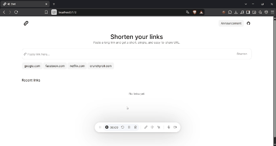

# shrt-link

A URL shortener built to test rapid-access redirection systems. Using vite in the frontend and nodejs with express for the backend.

## Important Note
This project simulates an **in-memory database** using a temporary variable on the server. Because Vite and Express are running together in a non-standard setup, **restarting the server will permanently delete all shortened links**. This is a proof-of-concept and is not intended for production use.